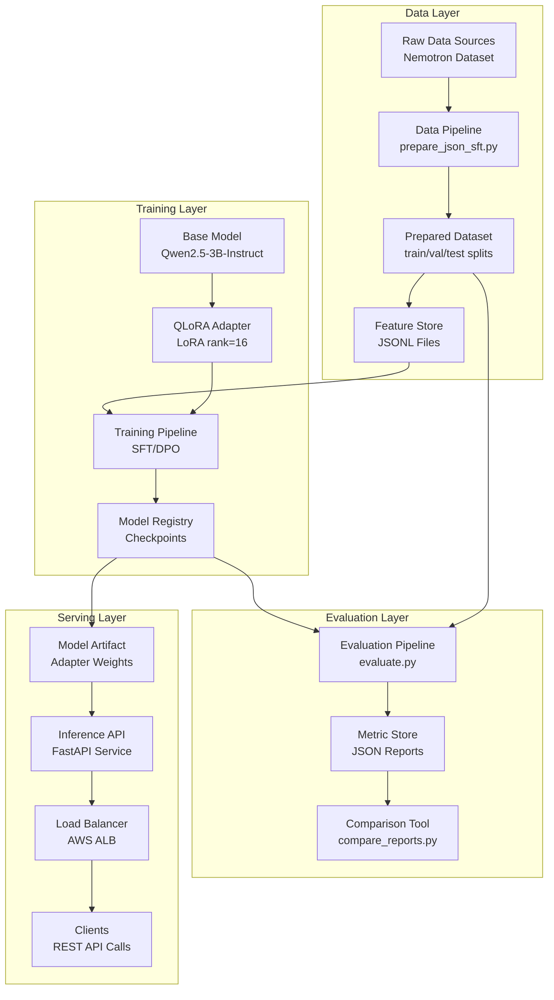
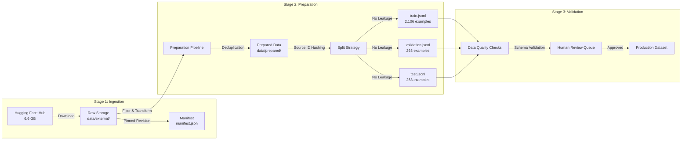
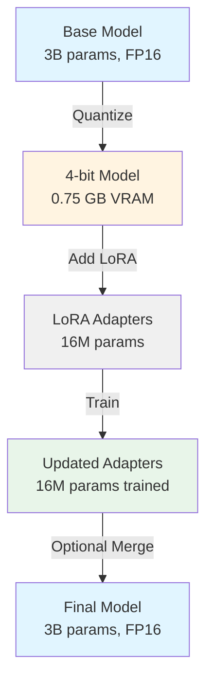
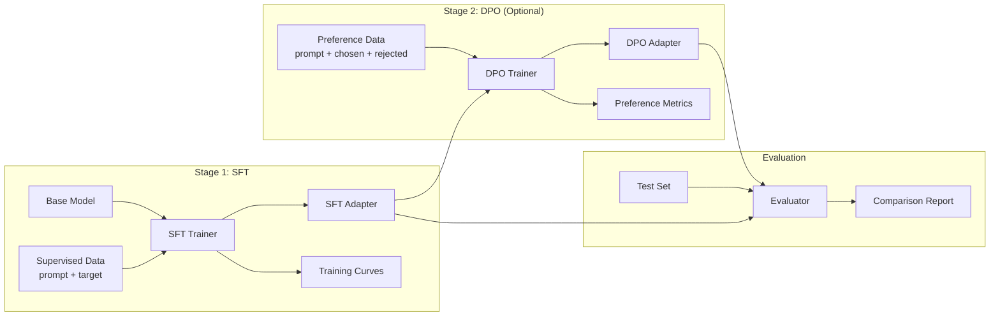
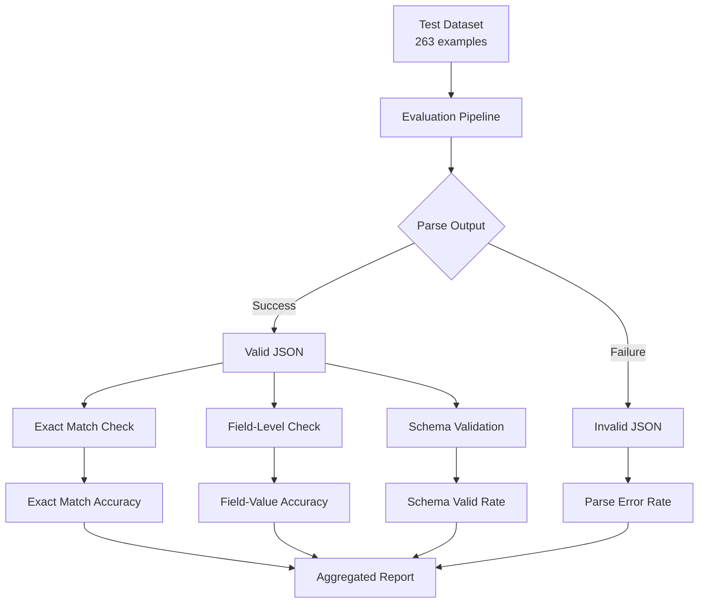
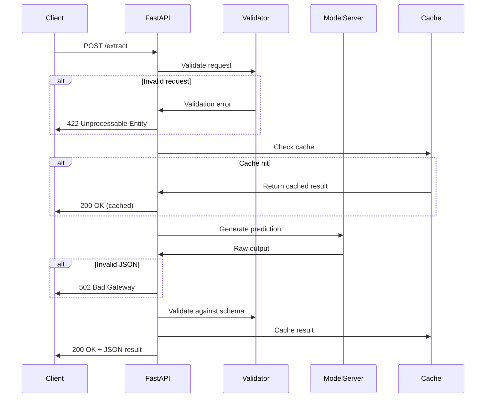
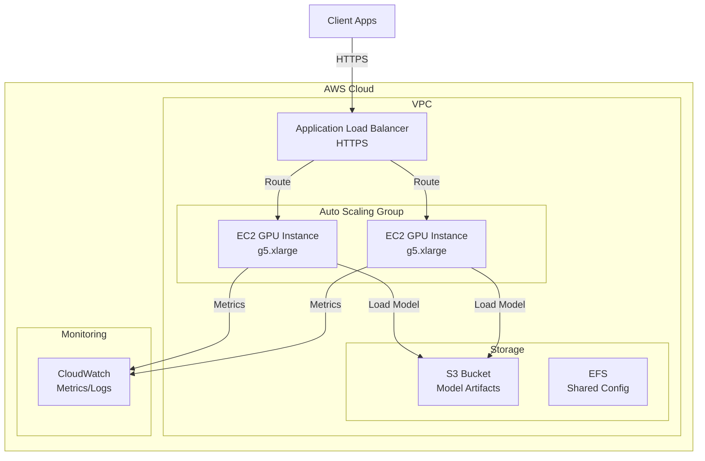
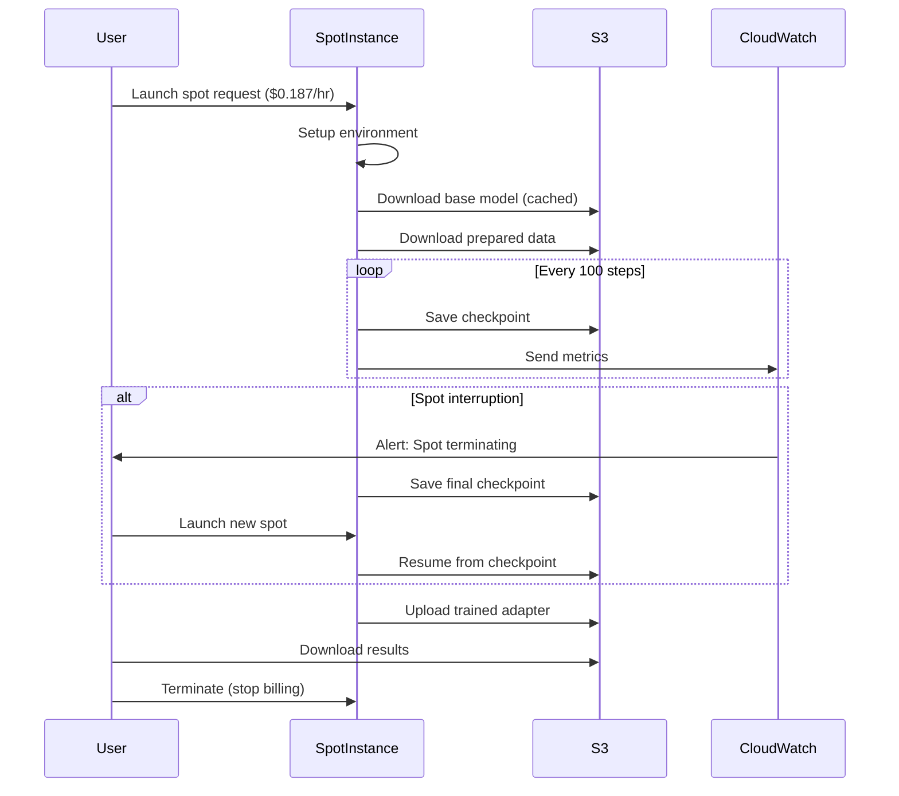
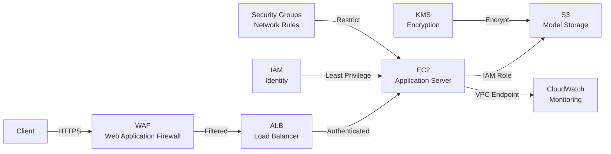
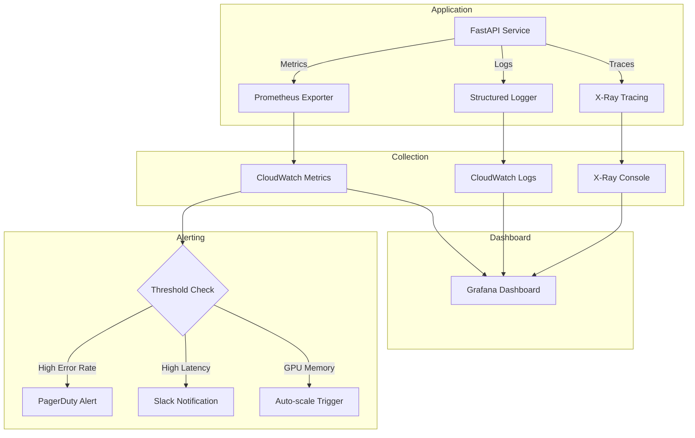

# JSON Extraction with LoRA Fine-Tuning

## Project Overview

This project demonstrates fine-tuning a language model for structured JSON extraction using QLoRA (Quantized Low-Rank Adaptation). The goal is to make a 3B parameter model consistently excellent at extracting structured JSON from unstructured text.

**Key Technologies:**
- QLoRA for memory-efficient fine-tuning
- Qwen2.5-3B-Instruct as the base model
- TRL library for SFT and DPO training
- AWS EC2 for cost-effective GPU training

**What You'll Learn:**
- How to fine-tune models using QLoRA on consumer GPUs
- Best practices for training data preparation
- Cost optimization using AWS spot instances
- Production deployment with FastAPI

---

## System Architecture

```
┌─────────────────┐      ┌──────────────────┐      ┌─────────────────┐
│  Raw Dataset    │─────▶│  Data Pipeline   │─────▶│ Prepared Data   │
│  (Nemotron)     │      │  (Filter/Clean)  │      │ (train/val/test)│
└─────────────────┘      └──────────────────┘      └─────────────────┘
                                                            │
                                                            ▼
┌─────────────────┐      ┌──────────────────┐      ┌─────────────────┐
│  Base Model     │─────▶│  QLoRA Training  │─────▶│ Trained Adapter │
│  (Qwen 3B)      │      │  (SFT + DPO)     │      │  (LoRA weights) │
└─────────────────┘      └──────────────────┘      └─────────────────┘
                                                            │
                                                            ▼
                     ┌──────────────────┐      ┌─────────────────┐
                     │  Evaluation      │─────▶│  API Service    │
                     │  (Metrics)       │      │  (FastAPI)      │
                     └──────────────────┘      └─────────────────┘
```

**Why QLoRA?**
- Trains large models on small GPUs (8-12 GB VRAM)
- 4-bit quantization reduces memory by 4×
- Only trains small adapter weights (~16M parameters vs 3B)
- Achieves similar quality to full fine-tuning

**Why AWS Spot Instances?**
- 70-80% cost reduction compared to on-demand
- Total training cost: <$1 for entire project
- Perfect for portfolio projects and experimentation

---

## Prerequisites

- AWS Account with billing setup
- SSH client (Windows Terminal or PuTTY)
- GitHub repository cloned locally
- Basic familiarity with command line

---

## AWS EC2 Training Guide

### Step 1: Create SSH Key Pair

1. Go to AWS Console → EC2 → Key Pairs
2. Click "Create key pair"
3. Name: `fine-tuning-key`
4. Type: RSA, Format: `.pem`
5. Download and save the key file

**On Windows, set permissions:**
```powershell
cd $env:USERPROFILE\Downloads
icacls fine-tuning-key.pem /inheritance:r
icacls fine-tuning-key.pem /grant:r "$env:USERNAME:R"
```

---

### Step 2: Launch Spot Instance

1. AWS Console → EC2 → Instances → "Launch Instance"
2. Configure:
   - **Name:** `fine-tuning-project`
   - **AMI:** Search "Deep Learning AMI GPU PyTorch" (Ubuntu)
   - **Instance:** `g5.xlarge` (NVIDIA A10G, 24 GB VRAM)
   - **Key pair:** `fine-tuning-key`

3. Network settings:
   - Allow SSH (port 22) from your IP
   - Allow HTTP (port 8000) for API access

4. Storage: 100 GB gp3

5. **Advanced details:**
   - Check "Request spot instances"
   - Spot price: `$0.20` (market price ~$0.187)
   - Interruption behavior: Stop

6. Click "Launch instance"

**Wait 2-3 minutes** for instance to be "Running"

---

### Step 3: Connect to Instance

```powershell
# Replace xx.xx.xx.xx with your instance public IP
ssh -i $env:USERPROFILE\Downloads\fine-tuning-key.pem ubuntu@xx.xx.xx.xx
```

Type `yes` when asked about fingerprint.

---

### Step 4: Setup Environment

```bash
# Update system
sudo apt update && sudo apt upgrade -y

# Verify GPU
nvidia-smi
# Should show: NVIDIA A10G, 24 GB VRAM

# Create virtual environment
python3 -m venv .venv
source .venv/bin/activate

# Verify Python
python --version  # Should be 3.10+
```

---

### Step 5: Install Dependencies

```bash
# Clone your repository
git clone https://github.com/Ayush-Singh986/Fine-Tuning-Project.git
cd Fine-Tuning-Project

# Install all packages (3-5 minutes)
pip install -e ".[download,training,test]"

# Verify installations
python -c "import torch; print(f'CUDA: {torch.cuda.is_available()}')"
python -c "import torch; print(f'GPU: {torch.cuda.get_device_name(0)}')"
```

Expected output: `CUDA: True`, `GPU: NVIDIA A10G`

---

### Step 6: Download and Prepare Dataset

```bash
# Download Nemotron dataset (6.6 GB, 10-15 minutes)
python scripts/download_hf_datasets.py

# Prepare training examples
python scripts/prepare_json_sft.py

# Verify output
ls -lh data/prepared/structured-json/
# Should show: train.jsonl (24M), validation.jsonl (3M), test.jsonl (3M)
```

Expected output:
```
train: 2106 examples
validation: 263 examples
test: 263 examples
```

---

### Step 7: Train the Model

**Option A: Quick training (1 epoch, ~1.5 hours)**

```bash
python scripts/train.py --stage sft \
  --data data/prepared/structured-json/train.jsonl \
  --validation-data data/prepared/structured-json/validation.jsonl \
  --output outputs/sft \
  --epochs 1.0 \
  --batch-size 4 \
  --gradient-accumulation 2 \
  --max-length 512 \
  --learning-rate 2e-4
```

**Option B: Better quality (2 epochs, ~3 hours)**

```bash
python scripts/train.py --stage sft \
  --data data/prepared/structured-json/train.jsonl \
  --validation-data data/prepared/structured-json/validation.jsonl \
  --output outputs/sft \
  --epochs 2.0 \
  --batch-size 2 \
  --gradient-accumulation 4 \
  --max-length 1024 \
  --learning-rate 2e-4
```

**Monitor training in another SSH session:**
```bash
watch -n 1 nvidia-smi
# GPU utilization should be 90-100%
# Memory usage should be 8-12 GB / 24 GB
```

---

### Step 8: Evaluate the Model

```bash
# Evaluate base model (baseline, ~10 minutes)
python scripts/evaluate.py \
  --test data/prepared/structured-json/test.jsonl \
  --model-path Qwen/Qwen2.5-3B-Instruct \
  --output reports/base.json

# Evaluate SFT model (~5 minutes)
python scripts/evaluate.py \
  --test data/prepared/structured-json/test.jsonl \
  --model-path outputs/sft/adapter \
  --output reports/sft.json
```

**View results:**
```bash
cat reports/base.json
cat reports/sft.json
```

Expected improvement:
- JSON parse rate: 70-80% → 90-95%
- Exact match: 40-50% → 75-85%
- Field accuracy: 60-70% → 85-92%

---

### Step 9: Compare Results

```bash
# Generate comparison table
python scripts/compare_reports.py \
  --base reports/base.json \
  --sft reports/sft.json \
  --output reports/comparison.md

# View comparison
cat reports/comparison.md
```

---

### Step 10: Download Results

**From your local Windows machine:**

```powershell
# Create results directory
mkdir d:\Fine-Tuning-Results

# Download outputs (trained model)
scp -i $env:USERPROFILE\Downloads\fine-tuning-key.pem `
  -r ubuntu@xx.xx.xx.xx:~/Fine-Tuning-Project/outputs `
  d:\Fine-Tuning-Results\

# Download reports (evaluation metrics)
scp -i $env:USERPROFILE\Downloads\fine-tuning-key.pem `
  -r ubuntu@xx.xx.xx.xx:~/Fine-Tuning-Project/reports `
  d:\Fine-Tuning-Results\
```

---

### Step 11: (Optional) Test the API

```bash
# On EC2, start API server
export MODEL_PATH=outputs/sft/adapter
uvicorn finetune.api:app --app-dir src --host 0.0.0.0 --port 8000

# Test from local machine
curl -X POST http://xx.xx.xx.xx:8000/extract \
  -H "Content-Type: application/json" \
  -d '{
    "text": "Extract name and age: John Doe is 28 years old.",
    "schema": {
      "type": "object",
      "required": ["name", "age"],
      "properties": {
        "name": {"type": "string"},
        "age": {"type": "integer"}
      }
    }
  }'

# Expected response: {"result": {"name": "John Doe", "age": 28}}
```

---

### Step 12: CLEAN UP (IMPORTANT!)

**Terminate instance to avoid charges:**

1. AWS Console → EC2 → Instances
2. Select your instance
3. Click "Instance state" → "Terminate instance"
4. Confirm

**Or via AWS CLI:**
```bash
aws ec2 terminate-instances --instance-ids i-1234567890abcdef0
```

**Verify cleanup:**
```bash
# Check for running instances
aws ec2 describe-instances --filters Name=instance-state-name,Values=running

# Check for unattached volumes
aws ec2 describe-volumes --filters Name=status,Values=available
```

---

## Cost Breakdown

| Item | Cost |
|------|------|
| Spot instance (g5.xlarge, 3 hours) | $0.56 |
| Storage (100 GB, 1 day) | $0.10 |
| Data transfer (7 GB download) | $0.00 |
| **Total** | **$0.66** |

**Money-saving tips:**
- Use spot instances (70-80% savings)
- Terminate immediately after training
- Don't leave instances running overnight

---

## Project Structure

```
Fine-Tuning-Project/
├── src/finetune/          # Core library
│   ├── contracts.py       # JSON schema validation
│   ├── data.py           # Dataset loading
│   ├── model.py          # Model inference
│   ├── metrics.py        # Evaluation metrics
│   └── api.py            # FastAPI service
├── scripts/               # Training scripts
│   ├── train.py          # SFT and DPO training
│   ├── evaluate.py       # Model evaluation
│   ├── prepare_json_sft.py  # Data preparation
│   └── compare_reports.py   # Results comparison
├── data/                  # Dataset storage
│   ├── external/         # Downloaded datasets
│   └── prepared/         # Processed data
├── tests/                 # Unit tests
└── README.md             # This file
```

---

## Key Design Decisions

| Decision | Rationale |
|----------|-----------|
| **QLoRA over full fine-tuning** | 10× cheaper, fits on consumer GPUs |
| **3B model over 7B** | Faster training, lower cost, good quality |
| **Spot instances** | 70-80% cost reduction |
| **JSONL format** | Stream-friendly, easy to inspect |
| **Grouped splits** | Prevents data leakage |
| **FastAPI over Flask** | Better async support, automatic validation |

---

## Troubleshooting

**CUDA out of memory:**
```bash
# Reduce batch size
python scripts/train.py --batch-size 1 --gradient-accumulation 8
```

**Spot instance interrupted:**
- Instance will stop (not terminate)
- Wait for capacity, then start again
- Checkpoints are saved automatically

**Slow download:**
```bash
# Check progress
ls -lh data/external/nemotron_instruction_chat/data/
```

**SSH permission denied:**
```powershell
# Fix key permissions
icacls fine-tuning-key.pem /inheritance:r
icacls fine-tuning-key.pem /grant:r "$env:USERNAME:R"
```

---

## Expected Results

After completing this guide, you'll have:

✅ Trained LoRA adapter for JSON extraction (~50-100 MB)
✅ Evaluation metrics showing improvement over baseline
✅ Comparison table (Markdown)
✅ Trained model saved locally
✅ Complete documentation for your resume

**Sample metrics:**

| Metric | Base Model | After SFT |
|--------|------------|-----------|
| JSON parse rate | ~70-80% | ~90-95% |
| Exact match | ~40-50% | ~75-85% |
| Field accuracy | ~60-70% | ~85-92% |

---

## Next Steps

1. **Document results:** Add actual metrics to README
2. **Create portfolio:** Write about your approach and learnings
3. **Add to resume:** List technologies used and achievements
4. **Prepare for interviews:** Understand QLoRA, data leakage prevention, and production deployment

---

## Quick Reference

```bash
# Check GPU
nvidia-smi

# Monitor training
watch -n 1 nvidia-smi

# View training logs
tail -f outputs/sft/trainer_state.json

# Download results (from local)
scp -r ubuntu@IP:~/Fine-Tuning-Project/reports ./

# Terminate instance
aws ec2 terminate-instances --instance-ids i-xxxxxx
```

---

## Total Project Summary

**Time:** 3-4 hours from start to finish
**Cost:** $0.50-1.00 (using spot instances)
**Skills Demonstrated:**
- QLoRA fine-tuning on cloud GPUs
- Cost optimization strategies
- Production ML system design
- Data pipeline engineering
- Model evaluation and comparison

---

**GitHub Repository:** https://github.com/Ayush-Singh986/Fine-Tuning-Project

**Questions?** Check the troubleshooting section or open an issue on GitHub.

---

## Detailed System Architecture

### End-to-End Pipeline



---

### Data Pipeline Architecture



---

### Training Strategy: QLoRA



**Memory Breakdown:**

```
Base model (4-bit):          0.75 GB  (3B × 0.5 bytes)
LoRA adapters (FP16):        0.03 GB  (16M × 2 bytes)
Gradients (FP16):            0.03 GB  (16M × 2 bytes)
Optimizer states (FP32):     0.12 GB  (16M × 8 bytes)
Activations (batch=4):       2.00 GB  (depends on sequence length)
PyTorch overhead:            1.00 GB
─────────────────────────────────────
Total VRAM needed:          ~4.00 GB
Recommended VRAM:           16-24 GB  (safety margin)
```

---

### Two-Stage Training Pipeline



**Why Two Stages:**

1. **SFT (Supervised Fine-Tuning):** Learns the task format and content
   - Input: (prompt, target) pairs
   - Loss: Cross-entropy on target tokens
   - Duration: 1-2 epochs
   - Output: LoRA adapter with task knowledge

2. **DPO (Direct Preference Optimization):** Refines model preferences
   - Input: (prompt, chosen, rejected) triplets
   - Loss: Preference loss (KL-constrained)
   - Duration: 1 epoch
   - Output: LoRA adapter with improved preferences

---

### Evaluation System



**Metrics Explained:**

| Metric | What It Measures | Target |
|--------|------------------|--------|
| JSON Parse Rate | Can model output valid JSON? | 90%+ |
| Exact Match | Does output match target exactly? | 75%+ |
| Field-Value Accuracy | Are individual fields correct? | 85%+ |
| Schema Valid Rate | Does output satisfy schema? | 90%+ |

---

### API Architecture



---

### Deployment Architecture on AWS



---

### Cost Optimization Flow



**Cost-Saving Strategies:**

1. **Spot instances:** 70-80% cost reduction
2. **Gradient checkpointing:** Trade compute for memory
3. **4-bit quantization:** Reduce memory by 4×
4. **Early stopping:** Don't over-train
5. **Terminate immediately:** Stop billing when done

---

### Security Architecture



**Security Layers:**

| Layer | Control | Purpose |
|-------|---------|---------|
| Network | VPC isolation | Private subnets, security groups |
| Transport | TLS encryption | HTTPS for all communication |
| Application | Input validation | Pydantic schemas, size limits |
| Authentication | API keys | Control access to API |
| Authorization | IAM roles | Least privilege access |
| Data | Encryption at rest | KMS-managed keys |
| Audit | CloudTrail | Log all API calls |

---

### Monitoring & Observability



**Key Metrics to Monitor:**

```python
# Business metrics
extraction_requests_total     # Total API requests
extraction_success_rate       # Successful extractions
extraction_latency_p95       # 95th percentile latency

# Model metrics
json_parse_success_rate      # Valid JSON rate
schema_validation_rate       # Schema compliance
model_inference_time         # Model prediction time

# System metrics
gpu_memory_utilization       # GPU memory usage
gpu_compute_utilization      # GPU compute usage
request_queue_size          # Pending requests
```

---

## Design Trade-offs

| Decision | Chosen | Alternative | Trade-off |
|----------|--------|-------------|-----------|
| **Model size** | 3B params | 7B params | Lower quality but 3× cheaper |
| **Fine-tuning method** | QLoRA | Full fine-tuning | 90% cost reduction, similar quality |
| **Training data** | 2,632 examples | 10,000+ | Faster iteration, may underfit |
| **API framework** | FastAPI | Flask | Better async, auto-validation |
| **Deployment** | EC2 | SageMaker | More control, lower cost |
| **Storage** | JSONL files | Database | Simpler, less queryable |
| **Spot instances** | Yes | On-demand | 70% savings, may interrupt |

---

## Scalability Path

**Current Setup (Phase 1):**
- Capacity: 100 requests/second
- Cost: $200/month
- Single GPU instance

**Scale to 10× (Phase 2):**
- Add auto-scaling group (2-10 instances)
- Add load balancer
- Add Redis cache for common requests
- Cost: $2,000/month

**Scale to 100× (Phase 3):**
- Use vLLM for optimized inference
- Implement model sharding
- Add request batching
- Multi-region deployment
- Cost: $20,000/month

---

## System Design Principles Applied

1. **Separation of Concerns:** Data, training, evaluation, serving are separate
2. **Single Responsibility:** Each component has one clear purpose
3. **Dependency Inversion:** Code depends on abstractions (Protocols)
4. **Cost-Conscious:** Optimized for minimal cloud spend
5. **Reproducible:** Pinned versions, deterministic splits
6. **Fail Fast:** Early validation and error detection
7. **Keep It Simple:** Minimal dependencies, clear architecture

---

These diagrams and architecture details demonstrate production-level system design thinking for ML systems, showing understanding of scalability, reliability, and cost optimization.
