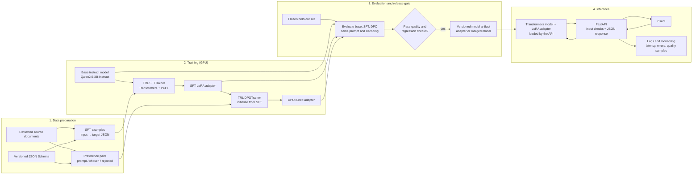

# JSON Extraction with LoRA and DPO

## Project in brief

This project tests whether fine-tuning can make a small instruction model more
reliable at turning a user request or unstructured context into one valid JSON
object. When a JSON Schema is supplied, the API also validates the result
against it. It uses supervised fine-tuning (SFT) with QLoRA, then Direct
Preference Optimization (DPO) to teach task-specific preferences.

The goal is not to make the model generally smarter. It is to measure whether
it performs this one task more consistently than the same base model with a
carefully written prompt.

**Status:** this repository includes a runnable training/evaluation/API
scaffold, a pinned downloader for the six linked datasets, sample-format data,
and tests. All six linked datasets are downloaded at pinned revisions: 93
source files totaling 21,272,297,436 bytes (about 19.8 GiB), recorded in
`data/external/manifest.json`. The small files under `data/*.example.jsonl`
are format examples, not the training corpus. The full upstream files are
stored under `data/external/`; they are deliberately not copied into the tiny
example JSONL files or committed to Git. I have also created a filtered
2,632-example JSON task corpus at `data/prepared/structured-json/`; its
deterministic train/validation/test splits contain 2,106 / 263 / 263 examples.
The Orca preference file has been converted into 12,857 usable pairs with
train/validation/test splits of 10,296 / 1,288 / 1,273 for an exploratory DPO
run.
Neither corpus is human-reviewed for the JSON task. GPU training and
before/after metrics have not been run; PyTorch is not installed in the active
workspace environment.

## Download the linked datasets

The downloader saves the original Parquet/JSONL/JSON/CSV files and each
dataset's README under `data/external/`, plus a manifest with pinned Hub
revisions, file names, and byte counts. Dataset files are git-ignored and
should not be committed to the source repository.

```powershell
python -m pip install -e ".[download]"
python scripts/download_hf_datasets.py
```

The `download` extra includes the Parquet reader used by the dataset inspection
and preparation utilities, plus Xet support for more reliable transfers of
large Hub files.

The full download includes all available UltraChat splits, both GSM8K
configurations and splits, both Nemotron files, the full Orca preference file,
all 50 OpenCodeInstruct shards, and all three OpenCoder SFT configurations.
It can require tens of gigabytes of disk space and a substantial download.
The downloader resumes files using Hugging Face Hub's cache/local directory
support. Select individual datasets with `--dataset gsm8k` or repeat the
option, for example `--dataset gsm8k --dataset orca_dpo_pairs`. Check each
source dataset's license and attribution requirements before redistribution or
use in a released model.

These sources do not all match the JSON task: UltraChat is general chat,
GSM8K is math, Orca is generic preference data, and the last two are code
corpora. I use only filtered, explicitly JSON-formatted Nemotron examples for
the initial SFT corpus. Downloading the other datasets preserves the
originals; it does **not** make them automatically appropriate for this task.

### What each linked dataset contains

| Dataset | Upstream data noted in its card | Best fit here | Important limitation |
|---|---:|---|---|
| [UltraChat 200k](https://huggingface.co/datasets/HuggingFaceH4/ultrachat_200k) | 207,865 `train_sft` and 23,110 `test_sft` examples; it also has generation splits | General chat SFT | Not a curated structured-JSON corpus |
| [Nemotron Instruction-Following Chat v1](https://huggingface.co/datasets/nvidia/Nemotron-Instruction-Following-Chat-v1) | 426,009 chat and 4,969 structured-output examples | Structured-output experiments | The structured-output subset mixes JSON, XML, and YAML tasks |
| [GSM8K](https://huggingface.co/datasets/openai/gsm8k) | 7,473 train and 1,319 test examples per config (`main` and `socratic`) | Math reasoning | Wrong task for structured JSON extraction |
| [Argilla Orca DPO pairs](https://huggingface.co/datasets/argilla/distilabel-intel-orca-dpo-pairs) | One preference-pair training split | DPO experiments | General chat preferences do not teach schema-following JSON behavior |
| [NVIDIA OpenCodeInstruct](https://huggingface.co/datasets/nvidia/OpenCodeInstruct) | 5,000,000 coding examples | Code SFT | Wrong task for this project |
| [OpenCoder `opc-sft-stage1`](https://huggingface.co/datasets/OpenCoder-LLM/opc-sft-stage1) | Three instruction configurations | Code SFT | Wrong task for this project |

The target for this project is **2,000–10,000 clean, task-relevant SFT
examples**, not an arbitrary 2,000 rows copied from any source. The prepared
corpus currently contains 2,632 machine-filtered examples: Nemotron
structured-output examples whose instructions mention JSON and whose final
answer parses as a JSON object, plus Nemotron chat turns where the final user
asks for JSON and the assistant returns a JSON object. Math and code examples
are not mixed into this JSON task. A human spot-check/review is still required
before treating these candidates as fully verified labels. The source license
and attribution requirements are preserved in the download manifest and must
be followed.

The supplied Orca DPO corpus is useful to exercise preference tuning, but its
pairs cover general tasks and do not label JSON extraction quality. The
preparation utility preserves those pairs as text and prevents identical
prompts from crossing splits; it removed two pairs whose chosen and rejected
responses were identical. Treat a run on it as an exploratory alignment
experiment only; use human-reviewed JSON-task preferences before claiming
task-specific DPO improvements.

### Why the example JSONL files have only a few rows

`data/sft.example.jsonl` has three illustrative rows and
`data/preferences.example.jsonl` has two preference pairs solely to show the
expected local project format. They are intentionally tiny fixtures for
smoke-testing loaders. They are **not** the linked datasets and are not the
training corpus. The prepared 2,632-row candidate corpus is written by
`scripts/prepare_json_sft.py` under `data/prepared/structured-json/`. The full
upstream files live under `data/external/<dataset-name>/` in their original
formats (including Parquet and JSONL). Keep these distinct:

1. **Raw corpus:** the untouched source files downloaded from Hugging Face.
2. **Prepared corpus:** rows selected, converted, quality-checked, and split
   for one defined training task.
3. **Example fixtures:** the tiny checked-in JSONL examples used by tests.

Do not replace these candidate rows with synthetic rows just to inflate the
count. The filter's count is not a claim that every answer has been
human-verified; complete that review before reporting the dataset as fully
clean.

## Project work log: from idea to deployment

This is the honest implementation record so far, written from the perspective
of the engineer building the project. It distinguishes completed engineering
work from work that still requires the real corpus, GPU training, and benchmark
execution.

1. **I defined a measurable task.** Following the brief, I avoided a general
   chat fine-tune and selected schema-conditioned JSON output from a request
   and its context. The model should return one JSON object and obey a supplied
   JSON Schema when present.
2. **I inspected the workspace.** There was no data pipeline, trainer, API, or
   test suite, so I implemented those rather than describing nonexistent code.
   I initially used invoice fields as a simple example, then changed the task
   to general JSON extraction after confirming that none of the provided
   corpora contains labeled invoices.
3. **I set up reproducible source ingestion.** The downloader pins each Hub
   revision and preserves source formats in a git-ignored directory.
   Large Hub transfers timed out over the initial HTTP route. I installed
   Hugging Face Xet support, increased the Hub timeout, and resumed from the
   local cache rather than discarding completed downloads.
4. **I measured the data-format mismatch.** Nemotron advertises 4,969
   structured-output examples, but the split mixes requested output formats.
   I did not count XML or YAML responses as JSON examples. A strict filter
   found 1,949 structured-output JSON-object responses with JSON in the
   instructions. By itself that was 51 short of the 2,000-example minimum.
5. **I solved the count shortfall without fabricating labels.** I inspected
   the linked Nemotron chat split and added only rows where the final user
   explicitly mentions JSON and the final assistant response parses as a JSON
   object. After exact duplicate removal, the preparation script produced
   2,632 candidate examples: 1,949 from structured outputs and 683 from chat.
   It split them by stable source ID into 2,106 train, 263 validation, and 263
   test examples. The report marks the corpus as not human-reviewed.
6. **I avoided train/test leakage.** The split groups records by source ID,
   and the task-specific preference splitter assigns a pair to the same split
   as its source record. The Orca preparation utility groups identical prompts
   before splitting. Baseline, SFT, and DPO evaluation use one frozen JSON test
   file; report comparison also checks the file hash and decoding settings.
7. **I matched the model interface to the new task.** Training data keeps
   conversation messages and JSON targets. Inference can take a request and
   optional JSON Schema; the API parses the generated object and validates it
   against that schema when provided. Malformed model output produces an
   explicit error, not a success-shaped response.
8. **I added testable checks.** The tests cover strict JSON parsing, optional
   schema validation, invalid dates in the invoice fixture schema, grouped
   splitting, prompt formatting, request bounds, and invalid model responses.
   The evaluation script measures JSON parse rate, exact match, and
   field-value accuracy; schema validity is reported only where an actual
   schema is provided.
9. **I kept the results honest.** I have not run SFT or DPO on a GPU, so there
   are no checkpoints, training curves, or measured before/after gains yet.
   PyTorch is not installed in this workspace, so I did not claim GPU
   availability or attempt model training. The 2,632 examples are
   machine-filtered candidates, not fully human-audited labels. The Orca
   converter prepares its generic preference pairs, but task-specific pairs
   still need human review before making a JSON-alignment claim.

### Remaining work before I can report project results

1. Human-review the 2,632 machine-filtered JSON candidates, remove any
   semantically incorrect examples, and regenerate source-level splits.
2. Review the converted Orca preference split for a clearly labeled
   general-preference experiment, or create task-specific preference pairs
   before claiming JSON-specific DPO results.
3. Run the prompted base-model benchmark, QLoRA SFT, and DPO on a compatible
   GPU using identical test examples and decoding settings.
4. Publish measured results, training curves, error slices, cost/runtime, and
   the trade-offs observed. Only then fill in the before/after table.

## Task and data

The task is to return a JSON object from a user request and context. The
optional schema defines the exact required fields and types. For example:

```json
{
  "contact": "Maya Patel",
  "appointment_date": "2025-06-10"
}
```

Require a single JSON object with no markdown. When the caller supplies a
JSON Schema, validate both the model output and the reference target against
that schema. Keep source conversation context intact, deduplicate exact
examples, and split by source ID. The held-out test set must not be used for
training or preference generation.

For DPO, create prompt / chosen / rejected triples from representative inputs.
The chosen answer should follow the schema and avoid unsupported guesses; the
rejected answer should demonstrate a real failure such as invalid JSON, a
wrong field, or an invented value. Review pairs for consistency before use.
Preference data can be created from model candidates and human-reviewed; do
not treat automatically generated preferences as ground truth.

## Project terminology: what the terms mean and why they are used

### Task and data

| Term | Plain-language meaning | Purpose in this project |
|---|---|---|
| **LLM (large language model)** | A neural network trained to predict and generate text. | It reads the request/context and generates the JSON response. |
| **Structured output / JSON extraction** | Returning information in a predictable machine-readable shape rather than free-form prose. | This is the narrow task being measured: produce one JSON object from a request and context. |
| **JSON** | A text format for objects, arrays, strings, numbers, booleans, and `null`. | It is the required output format; software can parse it and check its values. |
| **JSON Schema** | A machine-readable description of the permitted JSON structure, required fields, and value types. | The API can validate a generated object against a caller-provided schema instead of accepting merely parseable JSON. |
| **Dataset / example** | A collection of training or evaluation records; one example is one record in that collection. | Examples teach or measure the selected task. Counts alone do not prove that labels are correct. |
| **SFT example** | One supervised input and its expected assistant answer. In this project, the answer is a JSON object. | It teaches the model by showing desired outputs for prompts. |
| **Preference pair** | One prompt paired with a `chosen` answer and a less-preferred `rejected` answer. | DPO uses comparisons to adjust which answer the model prefers. The downloaded Orca pairs are general preferences, not reviewed JSON-extraction labels. |
| **JSONL** | A text file with one complete JSON value per line. | It is convenient for streaming, reviewing, and loading training examples. The `.example.jsonl` files are tiny fixtures; prepared data is stored separately. |
| **Parquet** | A compact, column-oriented file format commonly used for large datasets. | The Orca source is downloaded in Parquet and converted into JSONL for this project's trainer. |
| **Raw dataset** | The downloaded upstream data, preserved in its original format. | Keeping raw files separate makes it possible to reproduce or change preparation without downloading again. |
| **Prepared dataset** | Data converted, filtered, deduplicated, and split for the chosen task. | The trainer consumes prepared files, not every downloaded dataset indiscriminately. |
| **Data filtering** | Keeping records that meet explicit rules, such as a JSON-related instruction and an answer that parses as a JSON object. | It removes obvious format mismatches, but it does not verify semantic correctness; the current SFT candidates still need human review. |
| **Deduplication** | Removing repeated examples (or repeated prompt groups) so duplicates do not distort training or cross data splits. | It reduces over-counting and helps avoid near-identical evaluation examples leaking into training. |
| **Source ID** | An identifier linking an example back to its source record or prompt. | Grouped splitting uses it to keep related examples together. |
| **Train / validation / test split** | Training data updates model weights; validation data helps monitor or compare training choices; test data is held aside for final evaluation. | Keeping roles separate limits overfitting and makes the final comparison more credible. |
| **Data leakage** | Information from evaluation data, or a duplicate/related example, accidentally influencing training. | Grouping examples by source or prompt and keeping the test set unused during training helps prevent inflated scores. |
| **Hugging Face Hub revision pinning** | Selecting an exact commit of a dataset repository rather than always downloading its latest version. | It makes the source data reproducible; the downloader records the pinned revision in its manifest. |

### Model training

| Term | Plain-language meaning | Purpose in this project |
|---|---|---|
| **Base model** | The starting pretrained model before this project's task-specific training. | The proposed starting point is `Qwen/Qwen2.5-3B-Instruct`; the prompted base is also the comparison baseline. |
| **Instruction model** | A model additionally trained to follow user requests and conversational instructions. | It is a more suitable starting point for structured responses than a text-completion-only model. |
| **Fine-tuning** | Continuing training of a pretrained model on examples for a narrower behavior. | It tests whether consistent JSON behavior can improve beyond careful prompting. It does not automatically make a model generally smarter. |
| **SFT (supervised fine-tuning)** | Training on input/desired-output examples, using the desired answer as the target. | The first training stage teaches the model the JSON response patterns in the prepared corpus. |
| **DPO (Direct Preference Optimization)** | Training from prompt, preferred-answer, and less-preferred-answer comparisons, without a separate reward-model training stage. | The intended second stage adjusts preferences after SFT. It only supports a JSON-task claim if the preference pairs are relevant and reviewed. |
| **LoRA (Low-Rank Adaptation)** | A parameter-efficient method that trains small added weight matrices in selected model layers while leaving most base weights frozen. | It reduces the number of parameters that need updating and makes adaptation more practical on limited hardware. |
| **Adapter** | The small set of learned LoRA weights saved separately from the base model. | The SFT adapter stores the first-stage change; the proposed DPO adapter is trained from the SFT state. Serving needs the compatible base model as well as its adapter. |
| **QLoRA** | LoRA training while loading the frozen base model in low-bit quantized form, commonly 4-bit. | It reduces base-model memory use during training. Quantization does not eliminate the need for a compatible GPU or guarantee a particular result. |
| **Quantization** | Representing model weights with fewer bits than standard floating point. | The 4-bit base weights used for QLoRA take less GPU memory; adapters and computation still require memory. |
| **NF4** | A 4-bit quantization format designed for neural-network weight distributions. | The trainer config selects NF4 for QLoRA base weights. |
| **BF16 / FP16** | 16-bit floating-point number formats used for model computation. | The training code chooses BF16 when the GPU supports it, otherwise FP16 on CUDA. |
| **CUDA** | NVIDIA's platform for running computation on supported GPUs. | The current QLoRA path checks for CUDA because this training setup expects a CUDA GPU. |
| **PyTorch** | The deep-learning framework used to load and train the model. | Transformers, PEFT, and TRL use it for the training and inference code. It is not installed in the active workspace environment, so training has not run here. |
| **Transformers** | Hugging Face's library for pretrained model and tokenizer loading, generation, and training integration. | It loads the base model and tokenizer used by the scripts and API. |
| **PEFT** | A library for parameter-efficient fine-tuning methods, including LoRA. | It creates and loads the LoRA adapters rather than updating all base-model parameters. |
| **TRL** | Hugging Face's library for transformer reinforcement-learning and post-training workflows, including SFT and DPO trainers. | The training script uses its `SFTTrainer` and `DPOTrainer` interfaces. |
| **Tokenizer** | Software that converts text into model tokens (and generated tokens back into text). | Training and inference must use the tokenizer compatible with the base model. |
| **Chat template** | The tokenizer's formatting convention for system, user, and assistant messages. | Matching it during training and inference helps the model recognize message boundaries and the point where it should answer. |
| **Epoch** | One pass through the training examples. | The training configuration controls how many passes the trainer makes. |
| **Batch size** | The number of examples processed together for one training step on a device. | It affects memory use and training behavior; the script defaults to a small per-device batch for limited GPU memory. |
| **Gradient accumulation** | Combining gradients from several small batches before applying a weight update. | It increases the effective batch size without holding all examples in GPU memory at once. |
| **Gradient checkpointing** | Recomputing some intermediate values during the backward pass instead of storing all of them. | It trades extra computation for lower GPU memory use. |
| **Learning rate** | A setting that controls how large each training update is. | SFT and DPO need appropriately sized updates; the DPO script uses a lower rate than SFT by default. |
| **Sequence length / max length** | The maximum number of tokens the trainer keeps for an input and answer. | It limits memory and compute use; too small a limit may truncate useful context or answers. |
| **Loss** | A numeric training objective that measures model prediction error under the trainer's objective. | Training/validation loss can show learning trends, but lower loss alone does not prove better JSON extraction. |
| **Checkpoint** | A saved model or adapter state from a training run. | It allows evaluation, resuming, or rollback to a known training state. No trained checkpoints exist yet. |

### Evaluation and deployment

| Term | Plain-language meaning | Purpose in this project |
|---|---|---|
| **Baseline** | The reference result before applying the change being tested. | Here it is the base instruction model with a carefully written prompt, measured on the same test examples as later stages. |
| **Evaluation / benchmark** | Running a fixed set of examples through a model and calculating defined measures. | It is how the project would determine whether SFT or DPO helped; those benchmark results have not yet been run. |
| **JSON parse rate** | The fraction of generated responses that can be parsed as a JSON object. | It measures syntactic output reliability, not whether the values are correct. |
| **Schema-valid rate** | The fraction of outputs that satisfy a JSON Schema. | It checks required fields and types when a test example actually supplies a schema. |
| **Exact-match accuracy** | The fraction of outputs that match the reference object exactly. | It measures strict correctness, though harmless key ordering or formatting should be normalized before comparison. |
| **Field-value accuracy** | The fraction of evaluated field values that match the reference values. | It gives a more granular view when an object has several fields and only some are wrong. |
| **Refusal correctness** | Whether the model refuses only the examples that should be refused and answers the others. | It was suggested in the project brief, but the current extraction dataset does not define refusal labels, so this metric is not applicable yet. |
| **Decoding settings** | Generation controls such as maximum new tokens, sampling, and temperature. | Base, SFT, and DPO must use the same settings for a fair comparison. |
| **Frozen / held-out test set** | Evaluation examples fixed before comparing model variants and not used for training or tuning. | It prevents changing the benchmark to make a model look better after seeing its results. |
| **Training curve** | A plot of training or validation measurements over steps/epochs. | It helps inspect learning, instability, and overfitting; curves require actual training runs and are not available yet. |
| **Release gate** | A set of quality checks that must pass before promoting a model. | It prevents shipping an adapter that improves one metric but damages important behavior such as valid JSON output. |
| **Inference** | Using a trained model to generate an answer, rather than updating its weights. | It is the runtime action behind the extraction API. |
| **API (Application Programming Interface)** | A defined way for another program to send requests and receive responses. | The FastAPI service exposes `/extract` for JSON generation and `/health` for a health check. |
| **FastAPI** | A Python framework for building HTTP APIs. | It handles request validation, schema checks, model invocation, and JSON responses in this project. |
| **Docker container / image** | A packaged application environment; an image is the template and a container is a running instance. | It provides a repeatable way to run the inference API with its dependencies and model adapter. |
| **Deployment** | Making the application available in an environment where users or other services can call it. | The documented path packages the API and runs it on a GPU-capable host; deployment has not yet been performed. |
| **AWS EC2 / S3** | EC2 provides virtual machines; S3 provides object storage. | The suggested production design uses a GPU EC2 instance to serve the model and S3 to store model artifacts. |
| **Model artifact** | The versioned files needed to identify and load a trained model, such as base/adapter references, tokenizer, configuration, and evaluation report. | It makes a deployment reproducible and supports rollback. |
| **Monitoring** | Observing operational signals such as errors, response time, resource use, and sampled quality. | It helps detect service failures and quality regressions after deployment. |

## Architecture



## Step-by-step implementation and deployment

### Run locally

Use Linux (or WSL2 with CUDA configured) and a CUDA-capable NVIDIA GPU for
QLoRA training. Install a
PyTorch build compatible with the machine's CUDA driver before installing the
project's training extra if the default PyPI build is not suitable.

```bash
python -m venv .venv
source .venv/bin/activate
python -m pip install --upgrade pip
python -m pip install -e ".[download,training,test]"
```

For Windows-only development without a training GPU, install the API and test
dependencies and run the unit tests in PowerShell:

```powershell
py -3.12 -m venv .venv
.\.venv\Scripts\Activate.ps1
python -m pip install -e ".[test]"
python -m unittest discover -s tests -v
```

After the full Nemotron download finishes, build the filtered JSON candidate
corpus and inspect its report:

```bash
python scripts/prepare_json_sft.py
```

This produces `all.jsonl` and deterministic `train.jsonl`, `validation.jsonl`,
and `test.jsonl` files under `data/prepared/structured-json/`. Each row keeps
the source ID, source subset, conversation messages, and parsed JSON target.
Review the candidates before training; the script sets
`human_reviewed: false` in `report.json`.

Use the prepared splits for SFT and pass validation data so the training curve
is recorded:

```bash
python scripts/train.py --stage sft \
  --data data/prepared/structured-json/train.jsonl \
  --validation-data data/prepared/structured-json/validation.jsonl \
  --output outputs/sft
```

For an exploratory DPO run using the linked Orca data, first convert the
downloaded Parquet file. This writes prepared pairs and deterministic
train/validation/test splits under `data/prepared/orca-dpo/`:

```bash
python scripts/prepare_orca_dpo.py
```

The converter accepts non-empty prompts and chosen/rejected responses,
deduplicates exact pairs, and keeps identical prompts in one split. Its report
explicitly marks the data as not reviewed for the JSON task. These general
preferences can pull the model away from strict JSON output, so compare JSON
metrics and keep the DPO adapter only if it passes the release gate.

For a task-specific DPO claim, instead create a reviewed
`data/preferences_reviewed.jsonl`. Each row must contain a `source_id` from the
SFT corpus, the original `messages`, and different `chosen`/`rejected` JSON
objects. A human must verify that `chosen` is better for the requested
schema/task. Split preference rows alongside their source conversations, then
train DPO starting from the SFT adapter:

```bash
python scripts/split_data.py \
  --input data/prepared/structured-json/all.jsonl \
  --preferences data/preferences_reviewed.jsonl \
  --output-dir data/splits

python scripts/train.py --stage dpo \
  --sft-adapter outputs/sft/adapter \
  --data data/splits/preferences_train.jsonl \
  --validation-data data/splits/preferences_validation.jsonl \
  --output outputs/dpo
```

Validation loss is recorded in the Trainer state when validation files are
provided. For the Orca experiment, use its own prepared training and validation files:

```bash
python scripts/train.py --stage dpo \
  --sft-adapter outputs/sft/adapter \
  --data data/prepared/orca-dpo/train.jsonl \
  --validation-data data/prepared/orca-dpo/validation.jsonl \
  --output outputs/dpo-orca
```

The `scripts/train.py --stage dpo` command accepts string responses as well as
JSON-object responses. The training split is used for optimization and the
validation split for training diagnostics; the JSON task test set remains
untouched for final base/SFT/DPO comparison.

Evaluate all three variants against exactly the same sealed test file:

```bash
python scripts/evaluate.py --test data/prepared/structured-json/test.jsonl \
  --model-path Qwen/Qwen2.5-3B-Instruct --output reports/base.json
python scripts/evaluate.py --test data/prepared/structured-json/test.jsonl \
  --model-path outputs/sft/adapter --output reports/sft.json
python scripts/evaluate.py --test data/prepared/structured-json/test.jsonl \
  --model-path outputs/dpo/adapter --output reports/dpo.json
python scripts/compare_reports.py \
  --base reports/base.json --sft reports/sft.json --dpo reports/dpo.json \
  --output reports/comparison.md
```

Run tests and start the API with a trained adapter:

```bash
python -m unittest discover -s tests -v
MODEL_PATH=outputs/dpo/adapter \
  uvicorn finetune.api:app --app-dir src --host 0.0.0.0 --port 8000
```

In PowerShell, set the environment variable with
`$env:MODEL_PATH = "outputs/dpo/adapter"` before starting Uvicorn.

The API accepts `POST /extract` with a `text` field and optional JSON Schema:

```json
{
  "text": "Extract the person's name and age: Ada Lovelace, age 36.",
  "schema": {
    "type": "object",
    "required": ["name", "age"],
    "properties": {
      "name": {"type": "string"},
      "age": {"type": "integer"}
    }
  }
}
```

It returns `{"result":{...}}`, rejects overlong inputs or invalid schemas,
and returns an explicit `502` if generated output is not a JSON object or
fails the supplied schema. `GET /health` reports process health. Training
requires the Hugging Face model files and a compatible GPU; it is not run by
the test suite.

Build the inference container after training:

```bash
docker build -t structured-json-extractor .
docker run --rm --gpus all -p 8000:8000 \
  -e MODEL_PATH=/models/adapter \
  -v "$PWD/outputs/dpo/adapter:/models/adapter:ro" \
  structured-json-extractor
```

The container runs the FastAPI service with Transformers and loads the adapter
in-process; it does not install the training stack or provide a separate vLLM
server.
For a production AWS deployment, run it on a GPU EC2 host with the NVIDIA
container runtime, place the model artifact in a private S3 bucket, and
download it to a read-only model volume at startup. Put an HTTPS load balancer
in front, restrict access to the endpoint, use an instance role for S3 access,
and ship redacted operational metrics to CloudWatch. Do not bake model
credentials or private datasets into the image.

1. **Define the contract.** Finalize the task prompt, JSON Schema, field
   normalization rules, and behavior for missing or ambiguous values. Decide
   whether any inputs should be refused; if so, include labeled refusal cases
   and evaluate them separately.
2. **Build and validate the data.** Prepare 2,000–10,000 clean SFT examples and
   a reviewed preference set. Validate JSON and schema compliance, remove
   duplicates, check for sensitive data, and make train/validation/test splits
   by document source. Keep the held-out test set sealed.
3. **Choose a base model.** A 3B instruction model such as
   `Qwen/Qwen2.5-3B-Instruct` is a reasonable starting point. Confirm its
   current model-card terms, tokenizer/chat template, and intended usage before
   training or deployment.
4. **Run QLoRA SFT.** Pin versions of PyTorch, Transformers, TRL, PEFT,
   Accelerate, and bitsandbytes. Use 4-bit NF4 loading, BF16 where supported
   (otherwise FP16), gradient checkpointing, and a small LoRA adapter. Tune
   sequence length and batch size to the GPU memory; save checkpoints and
   training configuration. A 24-GB GPU is a practical starting point for a
   3B QLoRA experiment, but actual capacity depends on context length and batch
   settings.
5. **Evaluate the base and SFT models.** Use identical prompts, decoding
   settings, and held-out examples. Record JSON parse rate, exact-match
   accuracy, and field-value accuracy. Report schema-valid rate only on cases
   with an explicit machine-readable schema. Inspect failures by category
   instead of relying on loss alone.
6. **Run DPO from the SFT checkpoint.** Train on reviewed chosen/rejected
   pairs, starting from the SFT adapter, and retain the required reference
   policy/configuration for the selected TRL version. Track DPO loss and
   evaluate on the same held-out set. DPO may improve preferred behavior but
   is not guaranteed to improve every extraction metric.
7. **Apply a release gate.** Compare base → SFT → DPO. Promote only if the
   selected quality metrics improve and important slices do not regress.
   Keep the base and SFT checkpoints available for rollback.
8. **Package the model.** Store the tokenizer, model/adapter, schema version,
   training configuration, evaluation report, and dependency versions as one
   immutable, access-controlled artifact in Amazon S3. Either serve the
   adapter with a compatible server or merge it into the base model and
   validate the merged output.
9. **Deploy an inference API.** Build the provided Docker image containing a
   FastAPI service and a Transformers model backend. Validate requests,
   constrain input length, apply the agreed prompt/template, parse and
   schema-check model output, and return a clear error if generation is
   invalid—do not silently turn malformed output into success.
10. **Host and monitor.** For a small AWS deployment, run the container on a
    GPU EC2 instance (for example, a suitable G5 instance) behind an HTTPS
    load balancer. Give the instance least-privilege access to the model
    artifact; keep credentials out of the image. Send operational metrics and
    redacted logs to CloudWatch, monitor latency/errors and sampled quality,
    and define a rollback procedure. For managed training/hosting, use
    SageMaker instead. Test cost, cold-start time, throughput, and GPU memory
    before choosing the production size.

## Metrics to publish

Report measurements from the same frozen test set for all three checkpoints.
Use exact decoding settings and include the number of examples and confidence
intervals where practical.

| Metric | Base prompted | After SFT | After DPO |
|---|---:|---:|---:|
| JSON parse success rate | Not measured | Not measured | Not measured |
| JSON Schema validity rate (where schema supplied) | Not measured | Not measured | Not measured |
| Exact-match accuracy | Not measured | Not measured | Not measured |
| Field-value accuracy | Not measured | Not measured | Not measured |
| Refusal correctness | N/A for current task | N/A for current task | N/A for current task |

Do not fill these cells with estimates: populate them only after running the
benchmark. Also publish the training/validation loss curves and a short
failure analysis (for example, ambiguous dates, missing fields, and
hallucinated values). This makes the improvement—and any trade-offs—auditable.
